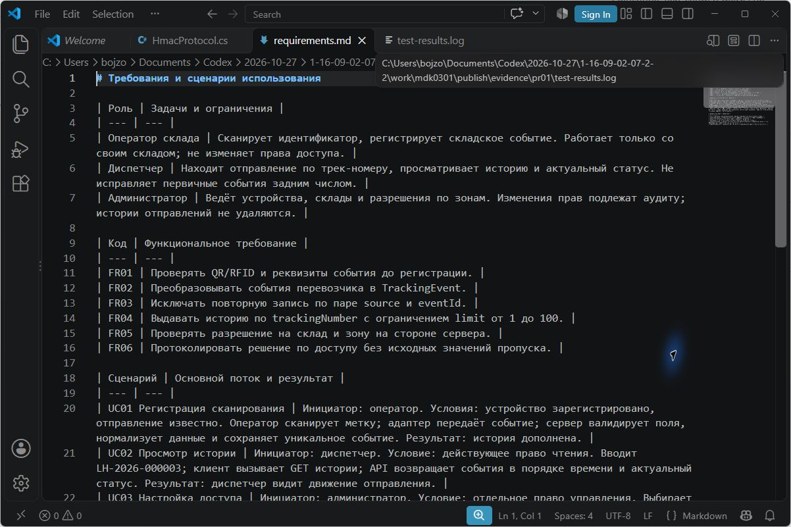

# ПР1 — Требования и структура репозитория

МДК.02.02, вариант 3. АИС «Логистический хаб».

Определены роли оператора склада, диспетчера и администратора, требования FR01–FR06 и три сценария использования. Описана структура решения и назначение каталогов.

## Материалы работы

- [Требования и сценарии](../../projects/LogisticsHub/docs/requirements.md)
- [Состав решения](../../projects/LogisticsHub/LogisticsHub.sln)

## Отчёт

- [Word](../../reports/Word/Бойцов_Пр1_МДК0202.docx)
- [PDF](../../reports/PDF/Бойцов_Пр1_МДК0202.pdf)
