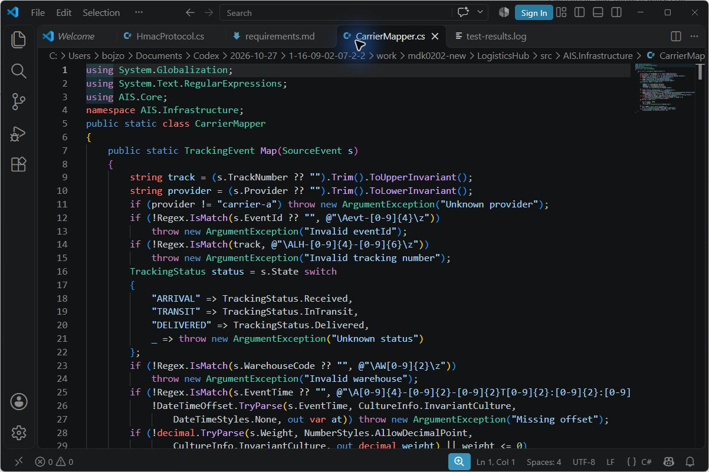

# ПР3 — Преобразование и сопоставление данных

МДК.02.02, вариант 3. АИС «Логистический хаб».

Данные перевозчика преобразуются в TrackingEvent: нормализуются трек-номер, статус, склад, время и вес. Проверяются недопустимые значения, дубликаты и конфликт событий.

## Материалы работы

- [Маппер событий](../../projects/LogisticsHub/src/AIS.Infrastructure/CarrierMapper.cs)
- [Модель данных](../../projects/LogisticsHub/src/AIS.Core/Domain.cs)
- [Хранилище событий](../../projects/LogisticsHub/src/AIS.Infrastructure/InMemoryTrackingRepository.cs)

## Отчёт

- [Word](../../reports/Word/Бойцов_Пр3_МДК0202.docx)
- [PDF](../../reports/PDF/Бойцов_Пр3_МДК0202.pdf)
