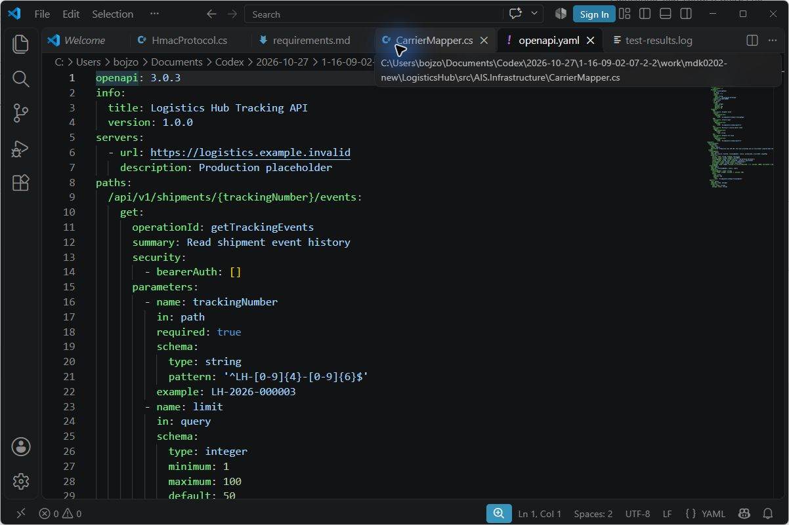

# ПР6 — Клиентская архитектура и OpenAPI

МДК.02.02, вариант 3. АИС «Логистический хаб».

Клиентская часть разделена по MVVM. Спецификация OpenAPI описывает получение истории отправления и ответы 200, 400, 401 и 404.

## Материалы работы

- [OpenAPI](../../projects/LogisticsHub/docs/contracts/openapi.yaml)
- [ViewModel](../../projects/LogisticsHub/src/AIS.UI/TrackingViewModel.cs)
- [HTTP-клиент](../../projects/LogisticsHub/src/AIS.Infrastructure/HttpTrackingClient.cs)

## Отчёт

- [Word](../../reports/Word/Бойцов_Пр6_МДК0202.docx)
- [PDF](../../reports/PDF/Бойцов_Пр6_МДК0202.pdf)
