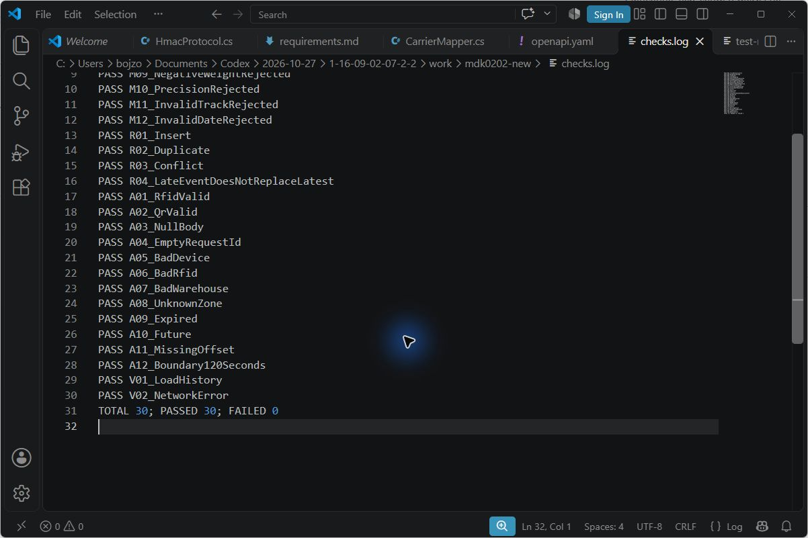
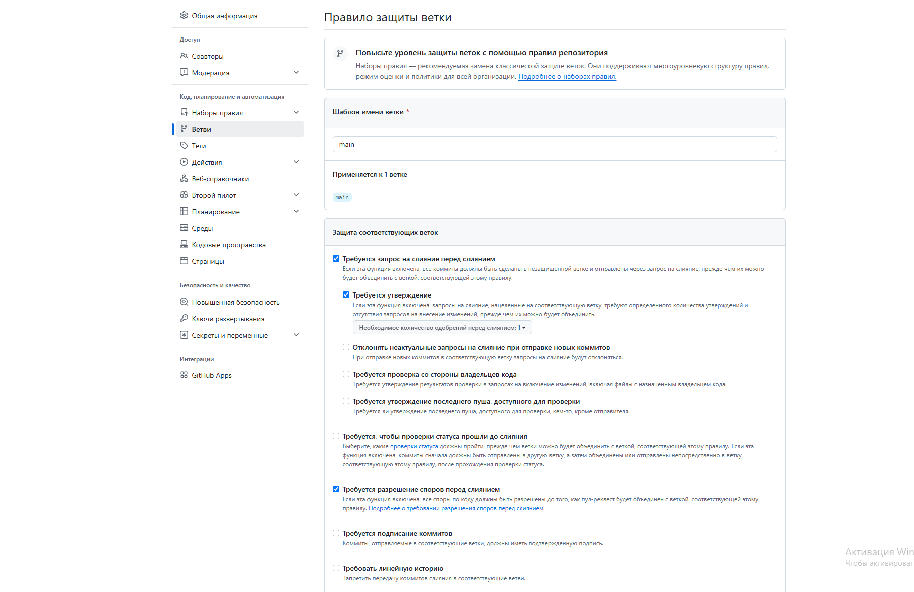
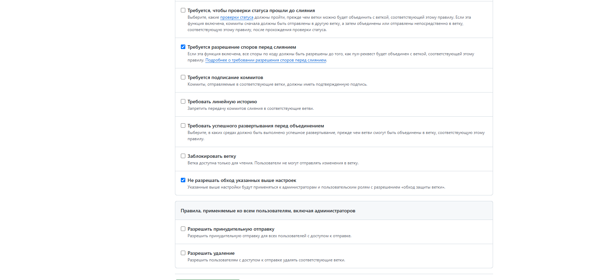

# ПР9 — Настройка Git и прав доступа

МДК.02.02, вариант 3. АИС «Логистический хаб».

Подготовлены исключения Git, правила окончаний строк и материалы проверки Git LFS. На GitHub включена защита main: обязательный PR, одно одобрение, разрешение обсуждений и запрет обхода правил. Force push и удаление запрещены. Обязательные автоматические проверки сборки и тестов пока не подключены. Проверки локального Git-сервера сохранены отдельно.

## Материалы работы

- [Правила защиты main](../../projects/LogisticsHub/docs/process/branch-protection.md)
- [Серверный обработчик Git](../../projects/LogisticsHub/ops/hooks/pre-receive)
- [Журнал проверки Git и LFS](../../evidence/git/git-verification.txt)

## Защита main на GitHub

## Отчёт

- [Word](../../reports/Word/Бойцов_Пр9_МДК0202.docx)
- [PDF](../../reports/PDF/Бойцов_Пр9_МДК0202.pdf)
